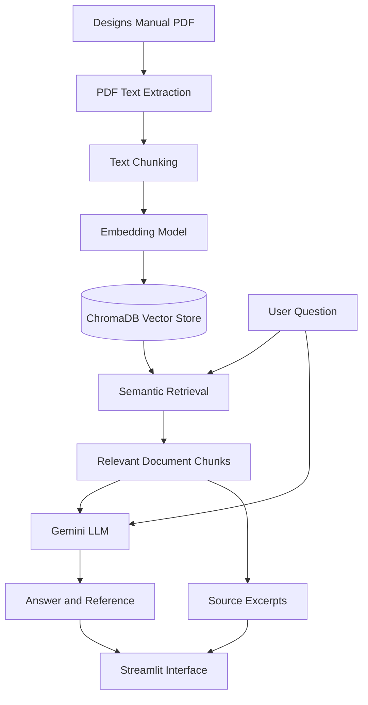

# Designs Law Assistant

A Retrieval-Augmented Generation (RAG) application that answers questions using the *Manual of Designs Practice & Procedure, Office of the CGPDTM*. The application retrieves relevant passages from the PDF, generates answers using Gemini, and displays source references and excerpts so users can verify the information.

## Features

- PDF-based question answering.
- Semantic search using ChromaDB and sentence-transformer embeddings.
- Gemini-powered answer generation.
- Source excerpts with PDF page references.
- A Streamlit web interface.
- A `Not found` response when the document does not support an answer.

## Tech Stack

- **Python** — application logic
- **LangChain** — document processing and LLM integration
- **ChromaDB** — vector database
- **Hugging Face Sentence Transformers** — text embeddings
- **Google Gemini API** — answer generation
- **Streamlit** — web interface
- **PyPDF** — PDF loading

## Project Workflow

1. Load the Designs Practice & Procedure manual PDF.
2. Extract text from the PDF.
3. Split the extracted text into smaller overlapping chunks.
4. Generate embeddings for the chunks.
5. Store the embeddings and document metadata in ChromaDB.
6. Convert the user's question into a semantic search query.
7. Retrieve relevant document chunks from ChromaDB.
8. Pass the retrieved context and question to Gemini.
9. Generate an answer using the supplied document context.
10. Display the answer, reference, and source excerpts in Streamlit.

## RAG Architecture



## Installation and Setup

### 1. Clone the repository

```bash
git clone YOUR_GITHUB_REPOSITORY_URL
cd designs-law-assistant
```

### 2. Create and activate a virtual environment

```bash
python3 -m venv venv
source venv/bin/activate
```

### 3. Install dependencies

```bash
pip install -r requirements.txt
```

### 4. Configure the Gemini API key

Create a `.env` file in the project root:

```text
GOOGLE_API_KEY=your_gemini_api_key
```

Use your own API key. Never commit the `.env` file to GitHub.

### 5. Add the source PDF

Place the manual at:

```text
data/designs_manual.pdf
```

### 6. Build the vector database

If the local vector database is not already built, run:

```bash
python main.py --index
```

This extracts the PDF text, creates chunks and embeddings, and stores them in ChromaDB.

### 7. Launch the application

```bash
streamlit run app.py
```

Open the local URL shown in the terminal, usually `http://localhost:8501`.

## Assignment Questions and Results

1. **How long does a proprietor have copyright in a registered design, and can it be extended?**  
   The manual states that protection lasts ten years from the date of registration and can be extended by five years upon application in the prescribed manner. Reference: Section 06.04, *Period of Protection*.

2. **Which classification system is used to register designs?**  
   Result: `Not found` — pending verification that the relevant passage is present in the manual.

3. **What is the government fee to register a trademark?**  
   Result: `Not found` — the manual-based assistant did not find a supported answer.

4. **Who is the current Controller General of Patents?**  
   Result: `Not found` — the manual-based assistant did not find a supported answer.

5. **What is the fee to register a design?**  
   Result: `Not found` — pending verification that the relevant passage is present in the manual.
